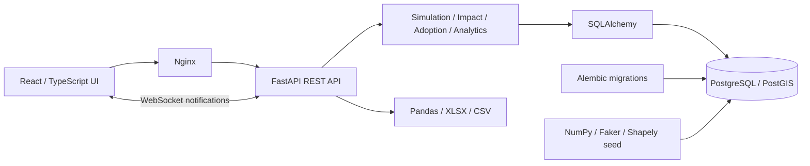
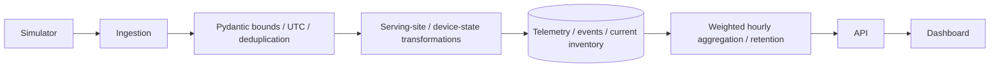

# MineOps

**Mining Network Operations Center & Private LTE Management Platform**

[Português](README.pt-BR.md) · [Five-minute demo](docs/demo-guide.md) · [Architecture](docs/architecture.md) · [Data model](docs/database.md)

MineOps is an executable engineering portfolio that connects a fictional private LTE network to mining operations. A backhaul failure becomes more than a red marker: the operator can see which equipment, industrial applications and operational areas depend on the failed site, then handle the resulting incident and restore service.

All operational data, coordinates, routes, workflows and sample SLA durations are synthetic and independently implemented. Aurora Mining is fictional. This is a local demonstration, not real network monitoring, certified RF prediction or an operational decision system.

## Three things to explore

- **Interactive operational map:** original mine benches, terrain contours, facilities and haul roads; labeled antennas with three directional coverage petals per site, nested signal bands and sector/azimuth inspection. Focus and expand the view, or optionally enable attributed OpenStreetMap street geography. Inspect serving-site dependencies directly from the map. [Map experience](docs/map-experience.md).
- **Real-time incident simulation:** persist backhaul, power, site availability, congestion, signal, latency, packet loss, device growth and missing-telemetry scenarios. REST actions and WebSocket notifications keep the UI consistent; polling remains available after a lost connection.
- **Planning integrated with operations:** create a connectivity request on the map, assess illustrative coverage, advance an original eight-stage workflow and activate a site into inventory, telemetry, KPIs and map layers.

## Operational Impact Analysis

The map includes a **Signal probe**: click an antenna or a point to query nominal signal band, candidate site and sector from backend geometry. Coverage remains explicitly simulated. The MineOps mark and favicon now use an original vector mining truck.

Seeded sites are distributed inside their assigned areas and an explicit mine perimeter. **Fit all towers** frames the complete network, including after viewport changes; stable markers preserve positioning across updates. Choose **Satellite · Esri · online** for attributed World Imagery beneath the fictional infrastructure. See [map experience](docs/map-experience.md) for online-source details and limits.


Select **SITE-LTE-014** in Network Map and choose **Simulate backhaul failure**. The seeded dependency graph produces:

| Application | Affected devices |
| --- | ---: |
| Fleet Management | 24 |
| Industrial Telemetry | 12 |
| Video Monitoring | 6 |
| **Total** | **42** |

The panel reports **42 devices, 3 applications and 1 area** because those relationships exist in the database. These numbers are not hardcoded in the UI; device additions and application assignments change the result. Recovery reconnects equipment and clears technical alarms. Human incidents remain open until the operator advances their workflow.

## Visual tour

[](docs/gallery.md)

Explore the **[18-screenshot feature gallery](docs/gallery.md)**: directional coverage, signal probing, map controls, NOC monitoring, alarms, simulation, adoption, inventory, devices and analytics. Captures show the running application with synthetic operational data.

| Operations and analytics | Planning and connectivity |
| --- | --- |
| [](docs/gallery.md#análise-e-configuração) | [](docs/gallery.md#planejamento-conectado-à-operação) |

Browse the [documentation index](docs/README.md) for the visual tour, demo walkthrough and engineering details.

## Run locally

Install Docker with Compose, then run from the repository root:

```sh
docker compose up --build -d --wait
```

Open [MineOps](http://localhost:3000), [Swagger/OpenAPI](http://localhost:8000/docs), or [API health](http://localhost:8000/api/health). There is no login: the **Demo Operator** profile is explicitly a shared local demo profile.

Compose starts PostgreSQL/PostGIS, applies Alembic migrations, seeds the database transactionally, launches the backend simulator and serves the compiled frontend through Nginx. No paid service, API key or external basemap is required. Downloading Docker images and dependencies requires internet on the first build; essential runtime functionality uses local services and geometry.

```sh
docker compose logs -f backend
docker compose stop
docker compose start
```

Database state is retained in the `mineops_db` volume. **Simulation Center → Reset demo** restores the original synthetic operational dataset and preserves audit logs. Browser tests also reset the demo.

Copy `.env.example` to `.env` to customize demo database credentials and tick interval. The database is not published to the host; HTTP ports are bound to loopback. See [technical decisions](docs/technical-decisions.md) for development options.

## What is included

13 API-backed pages: Overview, Network Map, NOC Monitoring, Alarms & Incidents, LTE Sites, Network Inventory, Connected Devices, Industrial Applications, LTE Adoption, Analytics, Simulation Center, Settings and About MineOps.

The initial seed contains 1 operation, 4 areas, 24 LTE sites, 72 cells, 500 devices, 12 applications, 150 infrastructure assets, 20 expansion requests, 40 historical incidents and seven days of hourly synthetic site telemetry. Synthetic vehicle routes, approximate coverage and a baseline capacity alarm are included. The default simulator then writes current samples every five seconds.


## Architecture and stack



Frontend: React, TypeScript, Vite, Tailwind, Radix primitives with local shadcn-style UI components, Lucide, Recharts, MapLibre, TanStack Query, React Router, React Hook Form and Zod. Backend: Python 3.12, FastAPI, SQLAlchemy, Pydantic, Alembic, PostgreSQL/PostGIS, Shapely, NumPy, Pandas, Faker and OpenPyXL. QA: Pytest, Ruff, ESLint and Playwright. Infrastructure: Docker Compose and GitHub Actions.



## API and exports

REST endpoints are grouped under `/api`: `health`, `overview`, `sites`, `cells`, `devices`, `applications`, `inventory`, `areas`, `coverage`, `alarms`, `incidents`, `adoption`, `analytics`, `simulation`, `settings`, `export`. Site details include equipment, cell sectors, alarms, history and `/sites/{id}/impact`. `/api/ws` sends invalidation notifications after committed mutations and periodic simulation ticks.

Collection endpoints support relevant searches, filters and pagination; invalid inputs return 422, missing records 404, invalid workflows 409. Swagger documents the exact parameters.

The dataset download includes CSV tables, a multi-sheet `mineops-demo.xlsx`, schema dictionary and fictional-data notice. Use **Export data**, any inventory download link, `/api/export`, or `scripts/export-demo.ps1`.

## Verification

```sh
docker compose run --rm backend pytest -q
docker compose run --rm backend ruff check app tests migrations scripts
```

For PostgreSQL/PostGIS domain tests, create a separate test database:

```sh
docker compose exec -T db createdb -U mineops mineops_test_local
docker compose run --rm -e TEST_DATABASE_URL=postgresql+psycopg://mineops:mineops_demo@db:5432/mineops_test_local backend pytest -q
```

The test harness refuses PostgreSQL database names that do not start with `mineops_test`. Default isolated tests use SQLite; the dedicated PostgreSQL run also exercises actual migrations, constraints, spatial columns and coverage queries.

```sh
cd frontend
npm ci
npm run lint
npm run build
npm run test:e2e
```

Windows browser tests use installed Microsoft Edge. On Linux CI, `npx playwright install --with-deps chromium` supplies Chromium. The browser suite requires the Docker stack at `localhost:3000` and resets its demo data. It checks all pages, impact, incident handling, expansion activation, theme switching and tablet layout, and creates the screenshots shown here. See [validation evidence](docs/validation.md) for the actual run results and limits.

## Documentation

| Document | Contents |
| --- | --- |
| [Feature gallery](docs/gallery.md) | 18 real screenshots with feature descriptions |
| [Documentation index](docs/README.md) | Visual and technical documentation navigation |
| [Architecture](docs/architecture.md) | Components, responsibilities and update flow |
| [Database](docs/database.md) | Entities, relations, spatial types and migrations |
| [Simulation](docs/simulation.md) | Scenarios, deterministic movement, recovery and reset |
| [Network model](docs/network-model.md) | Simplified LTE assumptions and impact semantics |
| [Adoption workflow](docs/adoption-workflow.md) | Original stages, deadlines and activation |
| [Data engineering](docs/data-engineering.md) | Validation, aggregation, KPI formulas and retention |
| [Demo guide](docs/demo-guide.md) | Five-minute recruiter walkthrough |
| [Technical decisions](docs/technical-decisions.md) | Tradeoffs, configuration and limitations |
| [Third-party notices](docs/third-party-notices.md) | Dependency licenses and asset provenance |

## Limits and roadmap

This MVP has a single-process simulator and shared local operator profile. It estimates impact from current serving-site associations, without real handover, redundancy, propagation, production auth or carrier integration. Routes and coverage buffers are simplified synthetic geometry. Historical availability is sampled, not measured uptime. Expansions are demo workflows; they do not establish real RF feasibility or real SLAs. Large map/chart libraries make the first frontend download heavier than a simple dashboard.

Potential future work: authenticated multi-user operations, a separately scheduled simulation worker, incremental geospatial writes, a more detailed synthetic terrain/sector model, multi-site incident relationships and query pre-aggregation for larger datasets. No performance benchmarks are claimed.

Original MineOps code is [MIT licensed](LICENSE). Dependencies and container services retain their respective licenses; the MIT license does not relicense PostGIS or third-party components.
