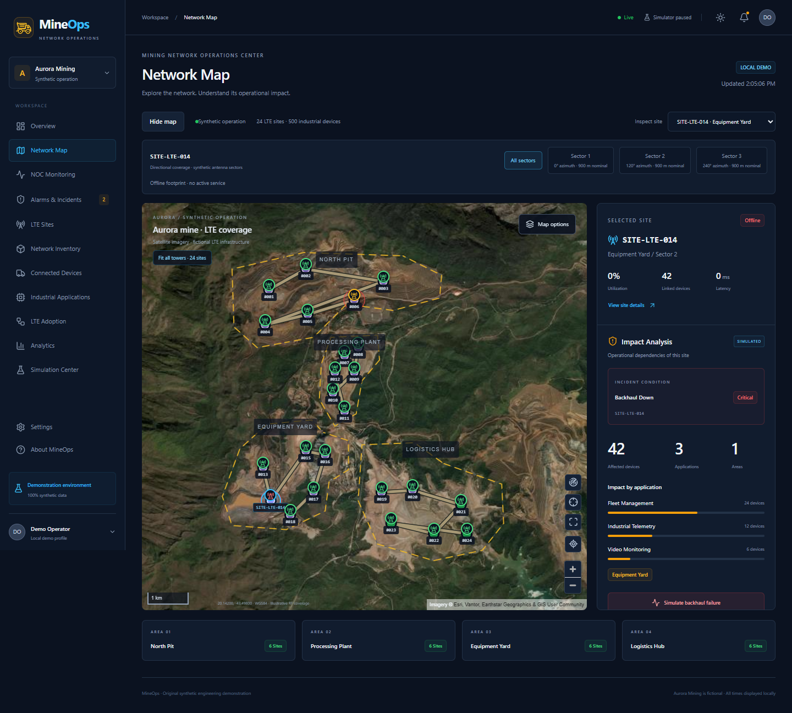
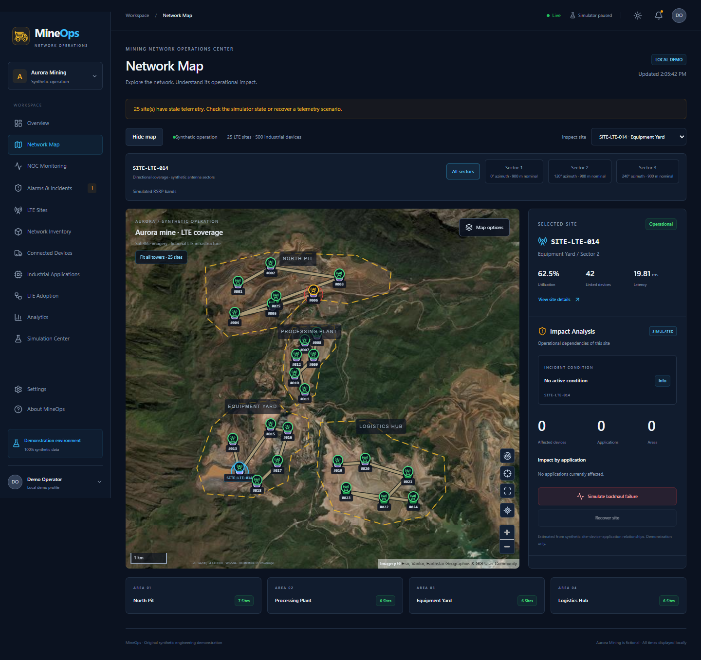
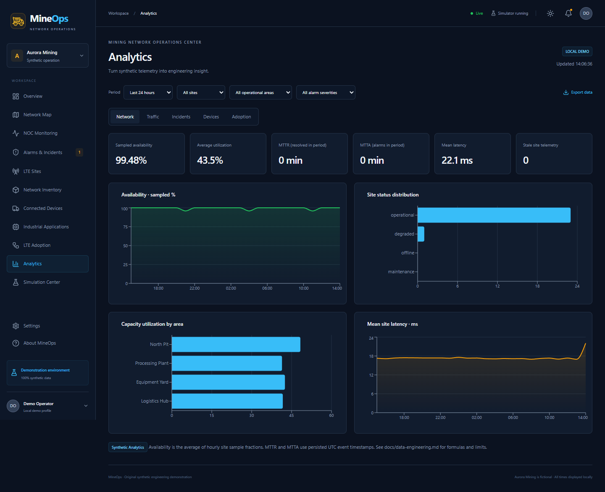
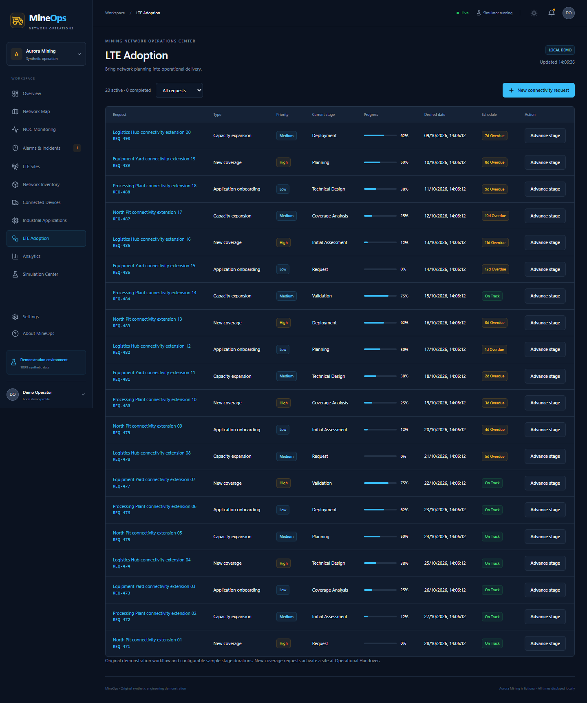

# MineOps — Mining Network Operations Center

[English](README.md) · [Roteiro de demonstração](docs/demo-guide.md)

Plataforma demonstrativa de operação e planejamento de uma rede LTE privada fictícia para mineração. Os destaques são o **mapa operacional interativo**, a **simulação de incidentes em tempo real** e a **integração entre planejamento e operação**.

O mapa agora inclui bancadas de lavra, relevo ilustrativo, reservatório, instalações e vias. Antenas identificadas exibem **três pétalas direcionais por site**, com faixas de sinal, filtro por setor/azimute, foco e modo ampliado. A base OpenStreetMap é opcional; a cena da mina funciona localmente. A identidade visual usa um caminhão de mineração em SVG. [Detalhes do mapa](docs/map-experience.md).

Use **Signal probe** para clicar em um ponto ou antena e consultar a faixa de RSRP, site e setor estimados pela geometria do backend. A cobertura continua demonstrativa e não corresponde a uma medição de campo.

Os 24 sites agora estão distribuídos dentro das áreas operacionais, com limite da mina destacado. **Fit all towers** enquadra todas as torres, inclusive após ampliar ou redimensionar o mapa. No seletor de base, **Satellite · Esri · online** permite visualizar imagens reais com atribuição; os ativos LTE continuam fictícios.

As áreas foram realinhadas às cavas visíveis na imagem de referência. **Map options** abre e fecha o menu; permite desligar bases, camadas e legendas. **Hide map** esconde o mapa inteiro e **Show operational map** o reabre. Os contornos são aproximações visuais para a demonstração, não limites oficiais da mina.

O painel **Impact Analysis**, integrado ao mapa, traduz falhas de telecomunicações em possíveis consequências industriais. A simulação de backhaul no SITE-LTE-014 afeta inicialmente 42 dispositivos, 3 aplicações e 1 área: Fleet Management (24), Industrial Telemetry (12) e Video Monitoring (6). Os totais são calculados pelas relações persistidas no banco e mudam conforme o cenário.



## Tour visual

[](docs/gallery.md)

Explore a **[galeria com 18 capturas reais](docs/gallery.md)**: cobertura por setor, consulta de sinal, controles do mapa, NOC, alarmes, simulação, planejamento, inventário, dispositivos e análise.

| Operação e análise | Planejamento e conectividade |
| --- | --- |
| [](docs/gallery.md#análise-e-configuração) | [](docs/gallery.md#planejamento-conectado-à-operação) |

A [documentação organizada por assunto](docs/README.md) reúne o roteiro de demonstração, a arquitetura e as evidências de validação.

## Executar

```sh
docker compose up --build -d --wait
```

Acesse [a aplicação](http://localhost:3000) e [a documentação da API](http://localhost:8000/docs). O Compose inicia PostgreSQL/PostGIS, migrações, seed, FastAPI, simulador e frontend React. Não é necessário hardware LTE, chave comercial ou serviço pago. O primeiro build precisa baixar imagens e dependências; a execução essencial funciona localmente.

A base inicial contém 24 sites, 72 células, 500 dispositivos, 12 aplicações, 150 equipamentos, 20 demandas, 40 incidentes históricos e sete dias de telemetria sintética. As 13 telas consultam a API. WebSocket notifica mudanças; polling e reconexão mantêm a interface atualizada quando necessário.

## Demonstrar

1. Abra Overview e consulte os indicadores derivados do banco.
2. Abra Network Map, selecione SITE-LTE-014 e simule uma falha de backhaul.
3. Observe dispositivos em vermelho e o impacto por aplicação.
4. Em Alarms & Incidents, reconheça o alarme e crie um incidente.
5. Recupere o site no mapa; investigue, resolva e feche o incidente explicitamente.
6. Em LTE Adoption, crie uma solicitação de **New coverage**, escolha um ponto na área correspondente e avance as oito etapas.
7. Ative o novo site e verifique mapa, inventário, células, telemetria e KPIs.
8. Baixe os dados demonstrativos em CSV/XLSX pelo botão de exportação.

O reset em Simulation Center restaura os dados operacionais sintéticos e mantém o log de auditoria. Os testes de navegador também reinicializam a demonstração.

## Testes

```sh
docker compose run --rm backend pytest -q
docker compose run --rm backend ruff check app tests migrations scripts
cd frontend
npm ci
npm run lint
npm run build
npm run test:e2e
```

No Windows, Playwright usa Microsoft Edge instalado. Os comandos para executar a suíte com banco PostGIS isolado estão no [README em inglês](README.md). Resultados efetivamente executados e limitações constam em [docs/validation.md](docs/validation.md).

## Dados fictícios e limites

Aurora Mining, coordenadas, topologia, rotas, nomes, aplicações, fluxos e prazos são fictícios e implementados de forma independente. Não foram usados dados de clientes corporativos. A cobertura é uma representação geométrica ilustrativa, o impacto é uma estimativa da simulação e a telemetria foi gerada artificialmente.

Este MVP não executa monitoramento LTE real, predição RF certificada, autenticação de produção ou decisões operacionais para uma mina verdadeira. A disponibilidade é calculada por amostras; não representa uptime medido. O simulador roda em um único processo de backend.

Código original sob [licença MIT](LICENSE). Componentes de terceiros e serviços Docker preservam suas próprias licenças. A documentação técnica completa e os diagramas estão em [docs](docs/architecture.md).
