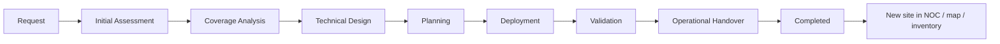

# LTE adoption: planning into operations

The workflow below is original to this demonstration. Names, planned stage durations and approvals do not reproduce a corporate process or customer SLA.

Requests record type, area, application, requester, justification, expected devices, map position, desired date, priority and technical owner. The UI uses React Hook Form/Zod and the API independently validates foreign keys, bounds, a future requested date and a point inside the chosen area polygon.

Click a location on the request's MapLibre scene or enter coordinates. The coverage assessment shows three nearby sites, synthetic buffer overlap/gap and an explicit recommendation to perform a separate real technical study. This is illustrative, not a feasibility assessment.

Eight stage records are created immediately with planned completion dates. Default duration is two days per stage, configurable for newly created requests. Completing a stage stamps its actual UTC time, advances the current stage and records an audit entry. Completion percentage is `completed stages ÷ 8 × 100` (rounded for display). Deviation is `actual completion time − planned time`, or `current time − planned time` for the unfinished current stage, in days. A pending stage with positive deviation is overdue; completed requests are no longer marked overdue.

On the last advance:

| Type | Persisted demonstration result |
| --- | --- |
| New coverage / Area expansion | A new operational site at the requested point, three cells, coverage polygon, route and first telemetry sample |
| Capacity expansion / Performance improvement | Nearest site in the area receives 50% more configured synthetic capacity |
| Application onboarding | The requested application is linked to the nearest site's current devices, preserving existing application links |
| New devices | Requested number of synthetic gateways is added to the nearest site and linked to the chosen application |

Site activation happens in the same transaction as the final stage, is idempotent through the completed-state guard, and publishes WebSocket invalidation. A second completion returns 409 instead of creating duplicate sites. Fresh sites participate in all subsequent simulator ticks and aggregate KPIs.

The test suite verifies a new coverage request through all eight stages and checks cells, map geometry, metrics and total sites. Additional domain tests verify capacity, onboarding and device additions. No real engineering approval, deployment or network configuration is performed.
