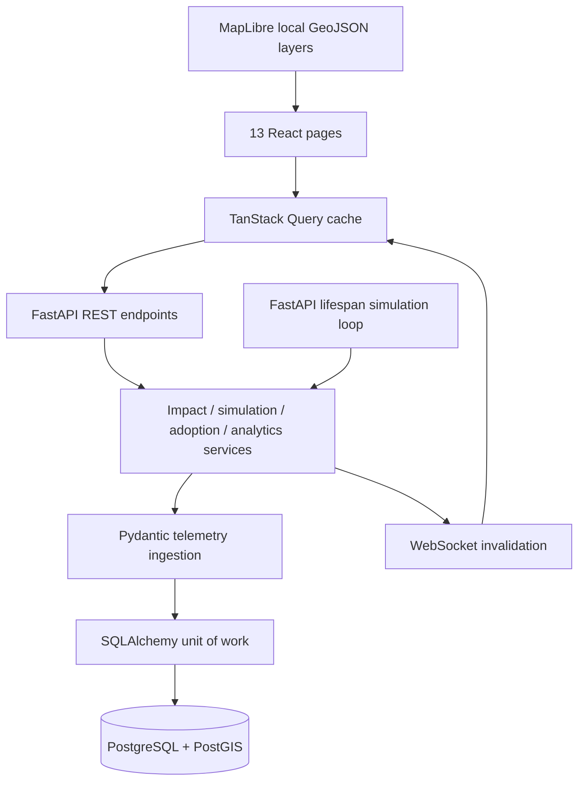

# Architecture

MineOps is a local three-service system. Nginx serves the built React client and proxies `/api` REST and WebSocket traffic to FastAPI. PostgreSQL/PostGIS stores master inventory, current serving-site relationships, telemetry, operational transactions, geospatial projections and audit logs. Alembic runs before the HTTP server becomes healthy; a transactionally seeded dataset makes the first run usable.

The simulator is an asynchronous lifecycle task inside one backend process. A process-local lock serializes mutations, reset and telemetry ticks. REST commits before publishing invalidation notifications. Clients fetch canonical state rather than maintaining a second independently evolving network model. Polling every ten seconds provides a fallback; WebSocket retries use capped exponential backoff.

The default mine scene uses local synthetic geometry with no external tile or glyph service. An optional attributed OpenStreetMap layer provides online street geography, without tile prefetch or scraping. Its MapLibre worker is bundled with Vite. Antenna markers, devices, planned expansions, directional cell coverage, terrain, roads and areas are separate layers; site/sector selection feeds the adjacent Impact Analysis panel. Labels and accessible antenna buttons use DOM markers with original text.

Code responsibilities:

- `backend/app/models.py`: normalized SQLAlchemy entities and constraints.
- `backend/app/schemas.py`, `ingestion.py`: request and telemetry validation.
- `backend/app/seed.py`: deterministic inventory, seven-day history, routes and geometry.
- `backend/app/services.py`: operational state transitions, dependency impact, hourly analytics and retention.
- `backend/app/main.py`: REST routing, lifecycle and WebSocket notifications.
- `frontend/src/pages`: independently implemented page experiences.
- `frontend/src/components`: map, impact panel, charts and local Radix/shadcn-style UI primitives.
- `frontend/src/api.ts`: HTTP errors, polling and reconnection.

The MVP deliberately uses one simulator process. Running multiple Uvicorn workers would create multiple loops and independent socket sets; use the shipped single-worker command. Horizontal scaling would require a distributed scheduler, shared event transport and a durable notification channel.
