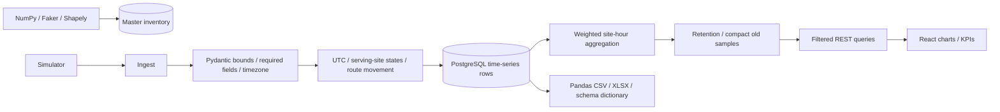

# Data engineering and KPI formulas

Master inventory is separate from telemetry, current device state, scenario events, alarms, human incidents and expansion transactions. Pydantic checks metric ranges and timezone-aware timestamps before writing live telemetry. Database foreign keys, a unique `(site_id,timestamp)` constraint and application-level duplicate checks protect referential integrity and repeated ingestion. Invalid or absent values are rejected; they are not replaced with fabricated zero measurements. A telemetry-unavailable scenario does not write a new sample.

Times are normalized to UTC; the browser displays them in the viewer's local timezone. Historical synthetic samples are seeded hourly for seven days. Current samples default to five-second intervals. `sample_count` preserves the number of original samples when records are compacted. A stored aggregate with count 10 and a new sample with count 1 combine with weights 10 and 1.

For time-window plots, samples are first grouped per site and UTC hour. Each field is averaged with `sample_count` weights inside that group. The network's hourly averages then give each observed site one contribution; this avoids treating frequently sampled live hours as more important than historical hourly samples.

| KPI | Formula / population |
| --- | --- |
| Total / operational / degraded / offline sites | Counts of persisted sites, optionally filtered by serving area/site |
| Availability | Mean of observed site-hour availability fractions × 100; degraded service remains available |
| Sampled downtime hours | Sum of `1 − site-hour availability fraction`; an illustrative sample-hour estimate |
| Connected devices | Devices whose current state is connected or degraded, excluding disconnected |
| Active alarms | Status Active or Acknowledged; optional site/area/severity filters |
| Critical incidents | Critical severity incidents not Resolved/Closed |
| Current utilization | Mean newest utilization sample across filtered sites |
| Current throughput | Sum newest site uplink + downlink, Mbps |
| Current latency | Mean newest site latency, ms; offline sites have 0 in this demo |
| Hourly throughput | Sum of each site's hourly average uplink + downlink |
| Hourly users | Sum each site's average served user count |
| MTTR | Mean `(resolved_at − opened_at) / 60 seconds` for resolved incidents opened in the chosen period |
| MTTA | Mean `(acknowledged_at − started_at) / 60 seconds` for acknowledged alarms started in the chosen period |
| Pending adoption | Requests with fewer than eight completed stages |
| Adoption progress | Completed stages ÷ 8 × 100, rounded for display |
| Stale telemetry | Age of newest metric exceeds configurable `stale_seconds` |
| Affected devices / apps / areas | Distinct serving-site-dependent device / application / area IDs for an offline or degraded site |
| Application data consumption | Sum synthetic device cumulative MB associated with that application; may overlap for multi-app devices |

Period selection applies to telemetry and incident aggregates; live inventory and application cumulative consumption are current snapshots. Site/area selection scopes applicable network/device metrics and application membership; area scopes adoption requests. Alarm severity scopes alarms and the incident severity breakdown. Metrics do not infer a severity from telemetry when no explicit scenario alarm exists.

Missing hours are absent from the chart and availability denominator; they are not assumed healthy or failed. Stale sites are flagged separately, and newest known values remain visible. MTTA/MTTR show 0 when there are no qualifying records, a display convention rather than a claim of instant response. These formulas are sampled demonstration analytics, not operational SLAs or measured physical uptime.

Every 12 ticks, samples older than 24 hours are compacted hourly with preserved weights; telemetry, device positions and scenario events older than configured retention are removed. Audit/incident/adoption transactions are retained. Retention is bounded from 7 to 90 days. The initial historical dataset has 4,032 site samples; current records increase within the configured retention policy.

Exports use Pandas and OpenPyXL to provide actual current tables, historical telemetry and a schema dictionary. The ZIP includes CSVs, a multi-sheet workbook and a fictional-data notice. Exported text beginning with spreadsheet formula prefixes is escaped.
