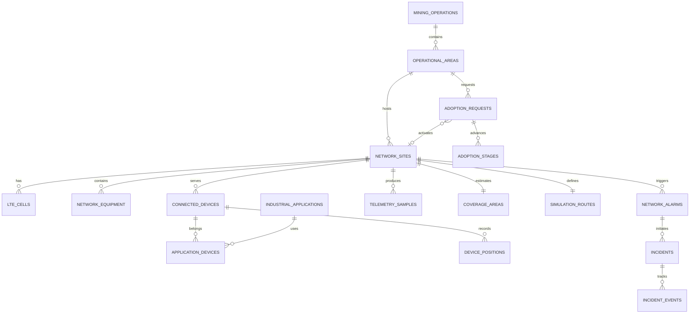

# Database and migrations

PostgreSQL 16 with PostGIS is the real Docker runtime database. SQLAlchemy defines the portable relational schema; Alembic adds indexed SRID 4326 spatial projections and a current-metrics view. SQLite exists for isolated development tests, not as the deployed geospatial engine.

| Entity | Meaning / integrity |
| --- | --- |
| mining_operations / operational_areas | Fictional operation and original area polygons |
| network_sites | Unique code, serving area, position, state, demo LTE parameters, capacity and timestamps |
| lte_cells / network_equipment | Site foreign keys; sector/azimuth and synthetic assets with unique serials |
| connected_devices | Current serving site, area, position, state, device signal measurements and route phase |
| application_devices | Composite primary key; many-to-many industrial application associations |
| device_positions | Time-indexed sampled mobile positions |
| telemetry_samples | Unique `(site_id, timestamp)`, utilization constraint, site metrics, availability fractions and aggregation sample weights |
| site_metrics | PostgreSQL view of the newest metric per site; API additionally queries latest timestamp per site |
| coverage_areas / simulation_routes | One synthetic coverage polygon and deterministic route per site |
| network_alarms | Separate start, acknowledgement and technical-clear timestamps |
| incidents / incident_events | Human workflow and timestamped action history; one serving site per demo incident |
| adoption_requests / adoption_stages | Request metadata, map position, original plan, completion timestamps; unique request/stage number |
| simulation_scenarios / simulation_events | Persisted original scenario catalog and auditable simulation actions |
| audit_logs / settings | Persistent mutation audit and validated demo settings |

Master GeoJSON and indexed PostGIS `geom` columns are synchronized in the same operational transaction. The projection is intentional: portable API geometry remains available, while PostGIS powers spatial coverage assessment. Point columns use `geometry(Point,4326)` for sites/devices; areas/coverage use `geometry(Polygon,4326)`; routes use `geometry(LineString,4326)`. Each has a GiST index. Site/device/metric/event foreign keys and temporal filters have B-tree indexes.

Migrations: `001` initial schema and PostGIS; `002` routes/scenario catalog; `003` sample weights; `004` directional coverage; `005` staggered towers; `006` excavation-reference alignment. The last migration replaces the area geometries and updates sites, device positions, routes, coverage and adoption coordinates together, retaining IDs and workflows. Migration 006 cannot be downgraded automatically; use a pre-migration backup to restore the previous spatial reference. `alembic upgrade head` runs before startup.

Seeding is idempotent for an initialized dataset. Reset deletes only demo operational tables in dependency order, restores explicit master identifiers, synchronizes PostgreSQL sequences and commits atomically. Audit records survive. Site 014 keeps its identity across resets; later expansion sites receive new valid identifiers.

The downloadable CSV/XLSX data dictionary records table, column, type and nullability. Additional semantic explanations are in this document and [network-model.md](network-model.md). UTC timestamps are normalized at API serialization, including SQLite test values that lose timezone metadata.
