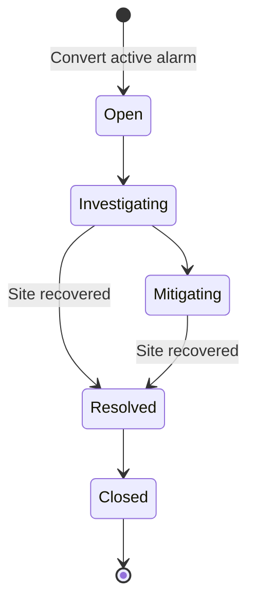

# Five-minute recruiter demonstration

This walkthrough demonstrates backend engineering, geospatial data, stateful workflows and industrial impact with only fictional information.

**0:00–0:40 — Overview.** Start the Docker stack and open `http://localhost:3000`. Show site count, connectivity, availability and throughput. Change the period to seven days to show seeded historical telemetry. Explain that the data is generated and the charts query persisted aggregates.

**0:40–1:30 — Operational map.** Open Network Map. Toggle coverage, devices and roads. Select SITE-LTE-014, inspect site details and linked devices. The default view opens site 014 to make the main demonstration easy to find.

**1:30–2:20 — Industrial impact.** Run **Simulate backhaul failure**. The site becomes red, linked devices highlight, and Impact Analysis shows 42 devices, 3 applications and 1 area. Explain Fleet Management 24, Industrial Telemetry 12, Video Monitoring 6. These totals come from a database dependency graph, not UI constants. Device Growth can change them to demonstrate this.

**2:20–3:15 — Human incident handling.** Open Alarms & Incidents, acknowledge Backhaul Down and create an incident. Move it to Investigating. Return to the map and recover the site. The technical alarm clears and devices reconnect; the incident remains Investigating. Resolve and close it explicitly. Show the persisted action timeline and Analytics MTTA/MTTR.

**3:15–4:30 — Planning into operations.** In LTE Adoption, create a **New coverage** request in North Pit, for Fleet Management, with a future desired date and original justification. Click inside the outlined North Pit; default `longitude=-43.4995, latitude=-20.1657` is valid. Advance the eight stages and activate SITE-LTE-025. Inspect its cells, coverage, route, telemetry and updated site count. Map options allows hiding overlays and inspecting the excavation imagery beneath the fictional assets.

**4:30–5:00 — Engineering and provenance.** Open Analytics or download the CSV/XLSX dataset. Show the Swagger API and architecture diagram. Close by explaining the original synthetic topology/workflows, independent implementation and explicit limits: no real LTE hardware, RF study, customer data or real operational diagnosis.

For another run, choose Simulation Center → Reset demo. This resets demo operational changes, incidents and expansions, and preserves audit logs. Pausing is useful for discussing a fixed scenario; resume to show movement and real-time samples.
