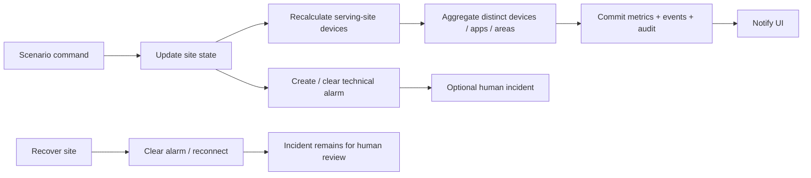

# Synthetic simulation engine

The backend owns simulation; frontend buttons invoke persisted commands. The default five-second loop is started and cancelled through FastAPI lifespan. Control state includes `running`, movement/data-consumption `speed`, deterministic `tick` and `seed=2026` in the settings table. Pausing stops new automatic metrics and movement; commands remain available. Start/resume turn the loop on. Reset restores baseline operational data and restarts the loop.

| Scenario | Original demonstration behavior |
| --- | --- |
| Site Offline / Backhaul Down / Power Failure | Offline site, Critical alarm, disconnected serving-site devices |
| Capacity Congestion | Degraded site, Major alarm, utilization around 94–97%, increased latency |
| Device Growth | Adds 25 persisted IoT devices, links Industrial Telemetry, creates Major capacity condition |
| Signal Degradation | Degraded site; device RSRP −120 dBm, RSRQ −18 dB, SINR 2 dB |
| High Latency | Degraded site and latency above 130 ms with Warning alarm |
| Packet Loss | Degraded site and 12% simulated packet loss with Minor alarm |
| Telemetry Unavailable | Stops the site's new samples; the UI eventually marks its telemetry stale |
| Site Recovery | Operational site, normal measurements, connected devices, cleared technical alarms |
| LTE Expansion | Separate eight-stage adoption journey activates inventory/coverage/cells/telemetry |

Identical active scenario commands are idempotent and do not add duplicate alarms/devices. Switching conditions clears the previous technical condition and creates the new one. Recovery does not delete devices added in growth scenarios; reset restores the 500-device baseline. Device growth and device adoption are bounded by a total 1,500-device demonstration limit.

Mobile equipment interpolates a persisted closed route near its serving site. Advancing phase by `0.007 × speed` per tick gives deterministic movement given the same initial state and sequence of commands. The routes remain inside the synthetic serving area. Positions are sampled every 12 ticks; coverage is not used as a professional signal model or a real handover algorithm.

Historic inventory and numeric telemetry are reproducible with seed 2026. Timestamps are relative to startup, so reproducibility applies to topology and values, not an identical absolute timestamp. Current utilization uses a bounded sinusoid by site and tick; fault commands apply explicit overrides. Fresh telemetry goes through Pydantic bounds, UTC validation and duplicate checks. Seven-day historical telemetry is generated in the seed transaction.

Settings define retention from 7 to 90 days (default 14). Every 12 ticks, older than 24 hours site telemetry is compacted into weighted hourly samples, and metrics/positions/scenario events older than retention are removed. Historic incident and audit records remain because they are operational transactions. See [data-engineering.md](data-engineering.md) for formulas.
